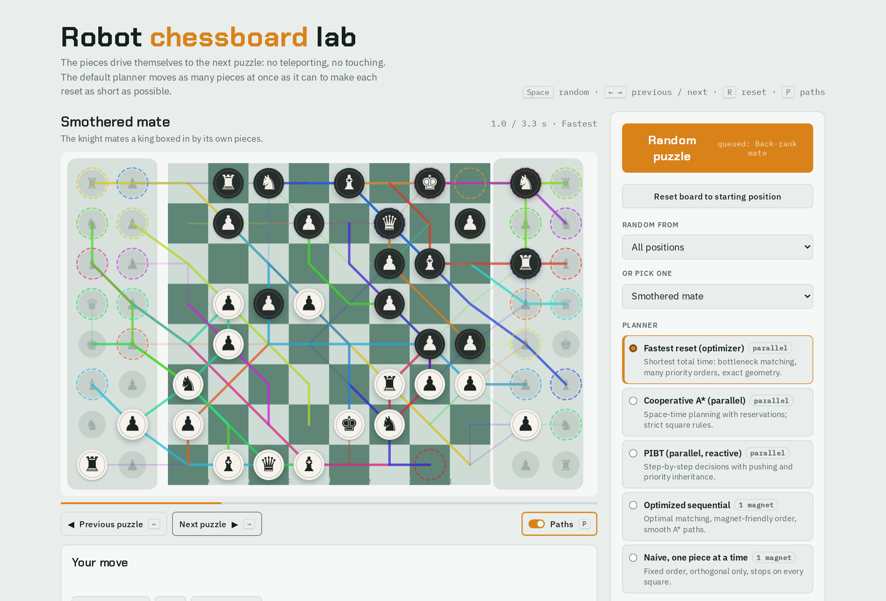
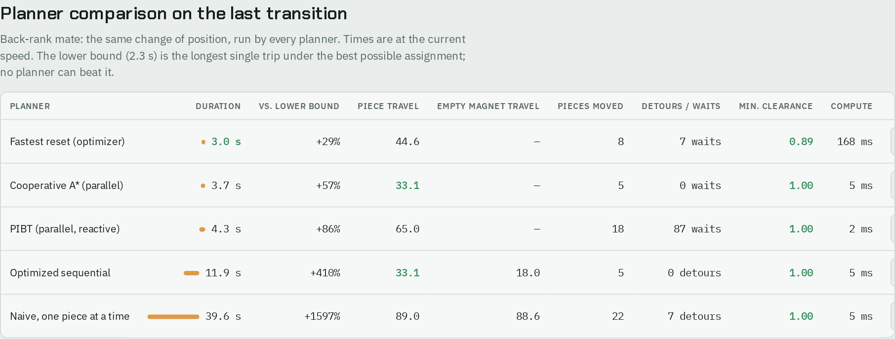
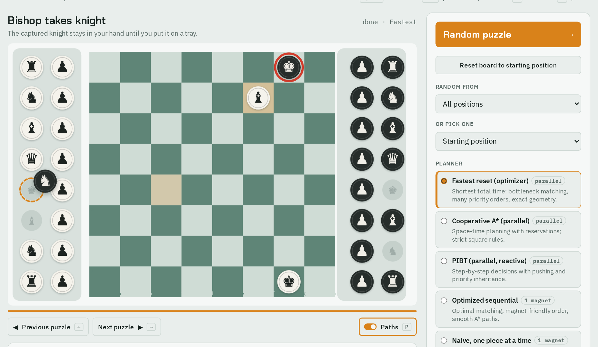

# Robot Chessboard Lab

A simulator for a self-moving chessboard. All 32 pieces drive from one position to the next, on a board with side trays for the pieces not in play: no teleporting and no touching. Five path planners can be compared on the same change of position, and the mate-in-two puzzles are playable, with the robot defending.

**[Open the live app](https://mmereu97.github.io/robot-chessboard-lab/)**



## The problem

The idea came from watching a commercial robotic board, the Chessnut Move, set up its pieces: I wanted to see how short and how smooth that choreography could get. Resetting a board is a multi-robot path-planning problem in a very tight space: up to 32 pieces, each of which must reach a square of its own type, while every other piece is in the way. A naive board moves one piece at a time and takes the better part of a minute. The interesting question is how close you can get to the theoretical limit if the pieces move together.

## The planners

| Planner | Idea |
|---|---|
| **Fastest reset** (default) | Bottleneck assignment, so the longest single trip is as short as possible; then many priority orders within about a second, moving the piece that arrives last to the front; moves checked with exact geometry; pieces with nowhere to go are left alone |
| **Pieces step aside** | Same matching, no grid: pieces are circles. Each trip takes the route that disturbs least; a piece too close to it slides off by the least that lets the circle pass and returns afterwards. Trips run together whenever they collide with nothing already under way. |
| **Cooperative A\*** | Space-time planning with reservations, one greedy priority order, strict square rules |
| **PIBT** | No long-term plan: at each step every piece moves towards its target, pushing and passing on priority when needed |
| **Optimized sequential** | One magnet under the board: Hungarian assignment, an order that keeps empty magnet travel short, A\* with diagonals and rounded corners |
| **Naive** | One magnet, pieces in board order, orthogonal moves only |

## Measured

All five planners on the same chain of 25 changes of position (every position in the app, in order), at 3 squares/s, with a piece diameter of 0.76 of a square. The lower bound is the longest single trip under the best possible assignment; no planner can beat it.

| Planner | Mean duration | Mean piece travel | Mean compute | Smallest distance between pieces |
|---|---:|---:|---:|---:|
| *Lower bound* | *2.2 s* | | | |
| Fastest reset | **2.8 s** | 78 squares | 434 ms | 0.89 |
| Cooperative A\* | 5.0 s | 104 squares | 74 ms | 1.00 |
| PIBT | 5.8 s | 152 squares | 1 ms | 1.00 |
| Optimized sequential | 37.3 s | 89 squares | 5 ms | 1.00 |
| Naive | 59.0 s | 138 squares | 1 ms | 1.00 |

- The default planner finishes about 30% above the lower bound, roughly 21 times faster than moving one piece at a time.
- Every plan completed, and no two pieces came closer than their diameter. The fallbacks are visible in the app: the two sequential planners can finish with serialized PIBT when their heuristic loops.
- The 12 mate-in-two puzzles were checked with the app's own solver: each has exactly one key move.

Pieces step aside was added later and measured on the same chain with the same diameter: a mean of **4.4 s**, against 2.7 s for Fastest reset, with about 3.6 pieces per change stepping aside, by 0.07 of a square on average and 0.41 at most, and the circles never closer than their diameter. On 80 random changes at a diameter of 0.78 it could not place a trip 3 times; it then uses Fastest reset and the comparison table marks it as a fallback. Above a diameter of about 0.84 this happens more often, because a row has little room left to open.

Compute times are from one run in headless Chromium and will differ on your machine. The Fastest reset planner has a time budget and randomised orders, so its numbers vary slightly between runs.



## Piece themes

Every piece is imagined as the same small robot, with the same round base, so only the drawing changes. Under Movement rules: **Discs**, **Lichess**, **Lichess, inside the base**, and the same **with circle**. The last two are for experiments where size matters: each symbol fits inside a circle as wide as the base the planner checks, invisible or drawn, so pieces that do not collide also do not overlap on screen. King and queen fill the circle, and the others follow the height order of a real set, down to the pawn. The circle follows the Piece diameter slider and starts at 0.78 of a square. The theme with the circle is the default. The Piece sizes tab, next to the board, sets how much of its circle each type of piece fills, in percent with one decimal: at 100% the symbol touches the circle. The board shows each change at once. The space between symbol and circle is gold for White and grey for Black by default; each side can have another colour or stay transparent.

That 78% is the usual guideline (1.75-inch king's base on a 2.25-inch square), not a FIDE rule. The current [FIDE equipment rules](https://handbook.fide.com/chapter/ChessEquipmentWithoutElectronicComponenets032026) give standard heights (king 95 mm, down to pawn 50 mm), a base diameter of 40–50% of each piece's height, and squares of 5–6 cm on which four pawns must fit. That allows a king's base of anywhere from 63% to 95% of the square.

A geometric consequence to keep in mind: a piece moving diagonally between two pieces on the side squares passes their centres at 0.707 of a square, so with equal bases it only fits if the base is at most 0.70. Only the Fastest reset planner uses the slider's exact geometry; the others follow strict square rules.

## Tidy trays

A piece not in play goes to the tray on its side of the board, whatever its colour: files a to d to the left tray, e to h to the right one. A piece already on a tray stays on that tray. Over 54 changes of position, on all six planners, none crossed to the other tray.

For the planners, the pieces not in play have a grid place on the two columns next to the board, the back column first, and on the outer two when those are full; on screen they lie in a heap around it. Duration alone is not what makes a move look right: a planner chasing only the clock will happily make pawns step aside to let a knight squeeze in behind them, which no person would do. So:

- a piece does not squeeze in behind another: the piece in front steps back and the newcomer takes its place;
- in the Fastest reset planner, pieces that stay put reserve their squares first, and each piece that has to step aside counts as extra duration.

Over the same 25 transitions (mean of three runs), pieces stepping aside with nowhere to go fell from about 44 to 1, at the price of 0.2 s per transition.

## Moving a piece

Drag a piece to its square, as on chess.com or lichess, or click the piece and then the square. A dragged piece is put down by you, so no robot carries it; the robots only clear what is in the way: a captured piece when captures by hand are off, the rook when castling. Dropped on a square it cannot go to, it returns home.

## The trays

The trays have no fixed places. Each is wide enough for all 34 pieces (the 32 of a game and two spare queens) in rows and columns at the chosen diameter, plus 10% of free room. A captured piece goes the shortest way to the nearest tray: along its rank to the tray's edge, stopping as soon as it is inside. The pieces already there move by the least that makes it fit, and stay where they were pushed. Dropped by hand, a piece lies where you put it, by the same rule. Untick the option and it goes to the tray of its colour instead.

Tested with 32 pieces going one by one to the same tray, at diameters from 0.6 to 0.9: they never overlap. When a tray is nearly full, a piece may not find room this way (between 0 and 5 of the 32, more at the largest diameter), and then it goes to a grid place on the tray instead.

Between positions too, the pieces not in play lie in a heap, at random and without touching. The planners work on a grid, but a piece that stays on a tray stays where it lies, one that leaves starts from where it lies, and one that arrives ends its trip in the heap. The planners do not see the heap, so the trays behave like magnets that repel: whatever lies there is pushed out of the way of what moves, by the least that keeps the distance, and a piece that has arrived drifts to its place in the heap only as far as nothing is in its way. A piece leaving a tray first goes to its grid place, and from there the planner's paths hold. Over 50 changes of position, in 47 no two pieces touched on the way; in the other 3 two pieces still overlap for a moment on a tray, and some of the 47 pass a little closer than the 3 mm. The clearance in the stats shows it. At rest the distance always holds. This costs about 0.3 s per change of position.

A captured piece that goes to a tray takes the straight way if that disturbs nothing. Otherwise several routes to the tray's edge are compared, between pieces too, and the cheapest wins: its length plus how far each piece has to step aside. So a rook leaving along the top rank past a king on h8 passes between the king and the h7 pawn, which move a little and come back, and nothing runs along the route.

You can reach into the trays at any moment of a game, on your turn or not: drag a piece, or click it and click where it goes, on the same tray or the other one. The pieces there make room. Drop it anywhere else, or press Esc, and it goes back where it lay. While the robots are moving, it waits on its new spot until they finish.

Pieces keep 3 mm apart, as magnets that repel would, taken on a 58 mm square (0.05 of a square). To everything that plans or places pieces, a piece is that much wider than it is drawn. On the chain of 25 changes of position this cost no measurable time: Fastest reset stays at 2.7 s and Pieces step aside at 4.5 s. A tray of 32 pieces still holds them all, none closer than that distance.

## Captures by hand

A person does not leave a captured piece to tidy itself away, so by default the app doesn't either. When you take a piece, it stays on your cursor while your own piece drives to the square. Nothing else can move until you drop it on a free place on either tray, wherever you like; in the mate-in-two puzzles the robot replies only after that. Its own captures still go to the tray by themselves. The option is under Movement rules.

Pieces are not tied to parking places: every plan starts from where the pieces really are. The next puzzle takes that knight from wherever you left it. Positions stay on the tray's grid, because the planners work on cells. A test with pieces shuffled across the trays passed on all five planners (12 of 12 transitions each, with no collisions).



## Play Stockfish

Set an Elo from 100 to 3000, pick a color and press Play Stockfish: the robots carry out both sides' moves on the board. The bot is the one from [chess-analysis-board](https://github.com/mmereu97/chess-analysis-board), copied with its calibration. Below Elo 1320 it plays and errs like a person: sound opening moves, moves played for an idea, instinctive checks, a rare blunder. An option, off by default, makes it stop making mistakes once it is a rook or more down; its Elo was calibrated with that rule on, so without it the bot is a little weaker when behind. From 1320 up it is Stockfish's own strength limit. Playing Black turns the board around. Games and puzzles are two tabs, and a win gets three seconds of fireworks. During a game a bar beside the board shows who stands better; a second Stockfish at full strength evaluates each position for 0.8 s, whatever the bot's Elo, and the bar can be switched off. Take back returns to your last turn: your move and the bot's answer are undone and the robots put the pieces back, captured ones included. The button counts how many times you used it. Under the board, each side's captures and who is ahead in material, by how many points (pawn 1, knight and bishop 3, rook 5, queen 9). The Elo you last played at is remembered, in the browser and, under serve.py, in lab-settings.json (ignored by git). The page opens on a game, with you as White against Elo 800; the engine starts with Stockfish's first move.

Below Elo 500 the brain cannot get any weaker, so part of its moves are chosen at random: from none at 500 to 80% at 100, for a child's first games. These levels are a slope, not a measurement. Against level 500, level 100 lost all of 14 games and level 300 lost 13 and drew one, so they are weaker, but their numbers are not calibrated Elo as the levels from about 540 up are.

A pawn reaching the last rank waits there: click a queen, rook, bishop or knight of yours on a tray (they are ringed), and that piece drives to the square while the pawn goes off the board. Buttons under the board do the same, and a click on the board takes the move back.

Missed a move? The buttons under the move list, the arrow keys (← →, ↑ for the first position, ↓ for the current one) or a click on a move show any earlier position. Only the picture changes: the game, the engine and the robots carry on underneath, and a click on the board returns to the current move. Resign asks once more before it ends the game, and the moves can still be looked through afterwards.

## Run

No packages are needed, only Python 3.8+ (or nothing at all, see below).

- **Online:** the [live app](https://mmereu97.github.io/robot-chessboard-lab/).
- **PyCharm:** open the folder, right-click `serve.py` > Run 'serve'. Your browser opens http://localhost:8000.
- **Terminal:** `python serve.py`.
- **Without Python:** double-click `static/index.html`.

## Files

| File | What it does |
|---|---|
| `static/index.html` | Page layout |
| `static/css/style.css` | Colors, fonts, layout (light and dark theme) |
| `static/js/engine.js` | Motion planning: grid, assignment (Hungarian, bottleneck), sequential planner, Cooperative A\*, PIBT, the fastest-reset optimizer, collision checking |
| `static/js/pieces.js` | The piece images (cburnett set, see License) |
| `static/js/puzzles.js` | Puzzle database (FEN positions). Add your own here |
| `static/js/chess.js` | Chess rules: legal moves, check, mate-in-two solver, robot defence |
| `static/js/app.js` | Drawing, animation, buttons, playing moves |
| `static/bot/` | The Stockfish bot: its brain and driver (`bot.js`), the engine, chess.js, the openings database |
| `serve.py` | Local web server for PyCharm |
| `index.html` | Entry page for GitHub Pages; redirects to `static/` |

## Adding puzzles

Add a line to `PUZZLES` in `static/js/puzzles.js`:

```js
{ name: 'Mate in two #79', desc: 'White to move.', fen: '6k1/5ppp/8/8/8/8/5PPP/3R2K1', set: 'm2' },
```

Puzzles of your own can stay off the public site: put them in `static/js/puzzles-private.js`, which git ignores and the page loads only on localhost (run `serve.py`). The file calls `PUZZLES.push(...)` with the same fields, plus `mine: true` and `chapter`, the group in the list, and optionally `sol`, the text that Show solution displays. With such a file, the page opens on the first puzzle not solved yet and offers only its puzzles, by chapter, with no Random. It shows a progress bar and a tick on each solved puzzle; `serve.py` keeps them in `puzzle-progress.json`, which git ignores, and the browser keeps a copy. A `CHAPTER_HELP` object in the file gives each chapter's explanation.

A puzzle can also have a `goal`, with `line`, the book's main line in SAN, and `side: 'b'` when Black moves first (the board then turns around):

- `goal: 'mate', n`: mate in n. The robot plays the book's replies. A different move counts if the solver proves that it still forces mate, and the robot then defends as long as it can.
- `goal: 'line'`: the book's line, and only that; `result: 'draw'` when the aim is a draw.
- `goal: 'place', place: { piece, square }`: take the missing piece from a tray with the mouse and put it on its square. With `placeMate`, any square that gives mate counts.
- `goal: 'view'`: free play, with the solution to read.

`set: 'm2'` makes the robot defend with Black and checks for mate in two; leave it out for free play. Only the piece-placement part of the FEN is needed. No side may have more pieces of a type than a normal set (e.g. two white queens), because the real trays only hold one set.

## Where to experiment

- **New planner:** add an entry to `ALGOS` at the end of `engine.js`. It receives start cells and target cells and must return segments (see `pathsToPlan`). The planner list in the page is built from `ALGOS` in `app.js`.
- **Movement rules:** `geomOK` inside `planCA` (exact clearance), and the piece diameter slider in the page.
- **Optimizer time budget:** `budget: 1000` in `opt()` in `app.js` (milliseconds).

## How it was built

I set the problem and the rules; the code was written with Claude Code under my direction.

## License

MIT, except `static/bot/`: the bot and Stockfish 18 are GPL-3.0 and chess.js is BSD-2-Clause, each with its license file there. The chess pieces are the cburnett set by Colin M.L. Burnett, from [Wikimedia Commons](https://commons.wikimedia.org/wiki/Category:SVG_chess_pieces), under its BSD license.
